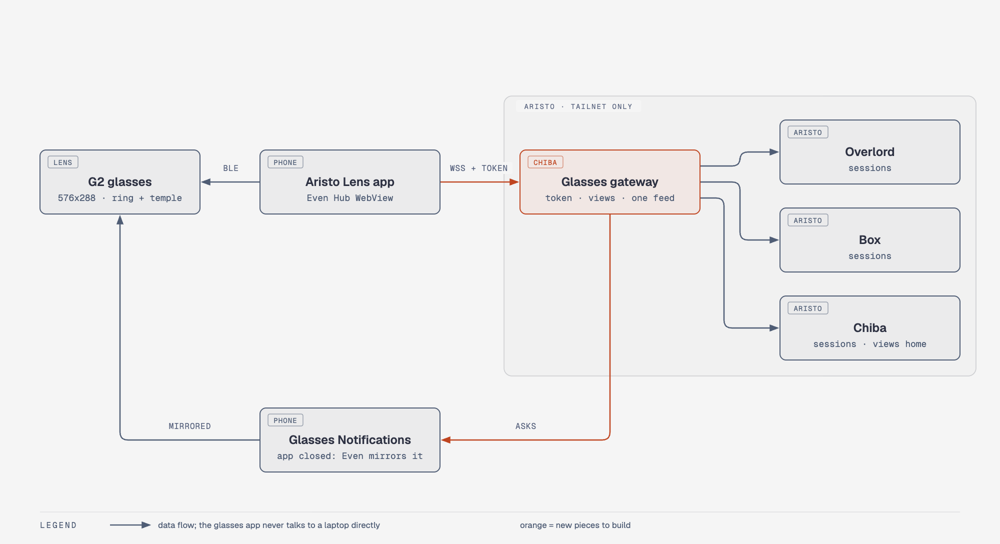
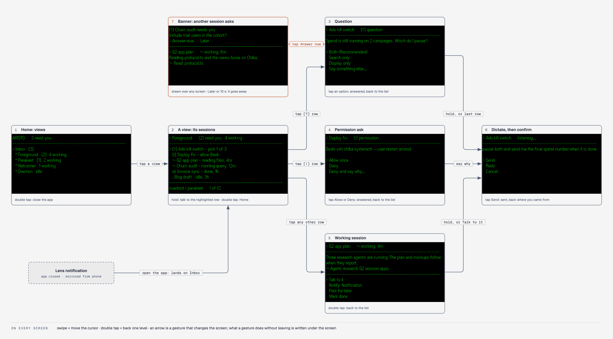
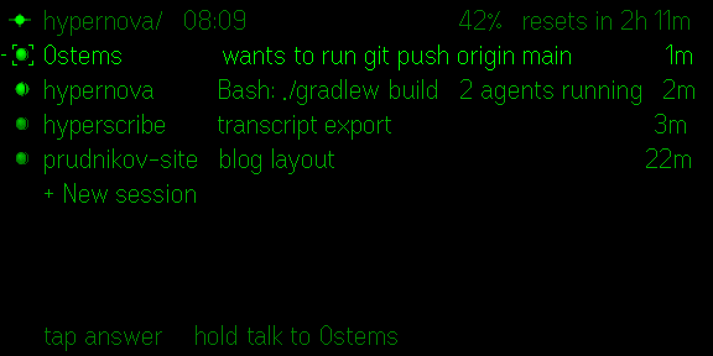

# Aristo on the G2 glasses: plan

An Even Hub app that talks only to Aristo on Chiba. Home lists Inbox plus starred views, waiting sessions come first, answers go by tap or voice. The glasses UI gate is built before the app.

## Build status

The build is running under one parent card (SC-9497). Two of three tracks are finished and live; the app is built and tested, and the install on the real glasses waits on the phone.

- **Glasses UI gate (SC-9498): done.** `ui-gate --surface glasses <app>` drives every state and gesture in the simulator on Box; it passes a good app and fails seeded defects.
- **Aristo gateway and shared logic (SC-9499): done, live on all three hosts.** A wrong token is refused, Home lists Inbox first with the real starred views, and asks arrive with Aristo's own text and options.
- **The app (SC-9500): passes the gate, beta 0.5.2 uploaded.** 26 states and 156 frames with no check errors and three of three critics passing; end-to-end tests pass against the real gateway code. The frames below are real simulator captures of the built app.
- **On the real glasses: installed, not connected yet.** Version 0.5.2 is on the phone and the phone reaches the gateway, but a settings-form bug cut the saved token short. Version 0.5.3 fixes it and is on beta; the update and token entry wait for the phone to be free.

## What was decided

Three choices were made on 2026-11-11. They fix the shape of everything below.

- **Session screens:** the app draws its own thread, question and permission screens. The built-in Terminal is not part of the flow.
- **Views on the home screen:** Inbox on top, then only the views starred in Aristo.
- **Build order:** the glasses UI gate comes first, proven on the existing Hub app, and the new app is built under it.
- **Dropped:** making Aristo imitate the Terminal protocol so views pair as Terminal hosts.

## How it connects

The glasses never talk to a laptop. The phone app holds one socket to a new gateway on Chiba, and the gateway reads the Aristo daemons on all three hosts.

- **Gateway on Chiba:** token-protected, evaluates views on the server, merges Overlord, Box and Chiba, sends compact rows plus pending asks.
- **Why a gateway:** Aristo's session socket has no token (it trusts the tailnet and an origin allowlist that a glasses WebView is not on), and it sends every message of every session to every client.
- **View engine:** lives in the web package today and moves to shared code so the gateway can run it.
- **App closed:** an Even Hub app cannot notify the lens while closed. Asks flagged for wearables go to the existing Glasses Notifications phone app, which the Even app mirrors. This is the backlog card SC-7913.
- **Opening the app after a notification:** it lands on Inbox with that session on top.

## What the research settled

Twenty-four open-source glasses apps were read from source, plus the SDK typings and Even's docs. Nobody ships saved views, and two platform limits shape the design.

- **No app can open the built-in Terminal** or deep-link into one of its sessions. The SDK has no launch call.
- **No app can notify the lens while closed.** Every project uses a phone notification the Even app mirrors.
- **Closest prior art:** muxway (an inbox, a "later" park, a banner over any page) and GlanceCode (counts in the header, hold to talk to the highlighted row).
- **Aristo already has the model:** views with filters, sort, grouping, a favorite flag and a notification level; sessions with a status; pending questions and permissions as separate records with their options.
- **Aristo is missing:** a token, a compact feed, and a wearable delivery route.
- **Saved for the build:** the survey table is in the `even-frontend` skill, `resources/open-source-apps.md`.

## The screens, as a flow

Seven screens cover the whole loop, drawn as a graph: each box is a real lens render and each arrow is the gesture that takes you to the next screen. Gesture hint lines are gone from every screen, which frees one to two rows each.

- **Reading it:** an arrow changes the screen; what a gesture does without leaving is written under the screen.
- **On every screen:** swipe moves the cursor, double tap goes back one level.
- **Answering:** tapping an option, Allow or Deny returns to the list, where the next waiting session is already on top.
- **Voice:** hold talks to the highlighted session from the list, a question or a working session; the reply always passes the confirm screen.
- **Two ways in from outside:** a banner while the app is open, a mirrored phone notification while it is closed.
- **Markers:** ASCII here because the offline renderer only knows ASCII; the build uses the firmware symbols.
- **Generator:** `flow-gen.mjs` next to this file redraws the graph from the screen renders in `flow/`.

## How glasses UI should look

Ten house rules, derived by looking at about 130 lens screenshots from 21 open-source apps. Even publishes no layout guidance, so these come from what the best-looking shipped apps do; every capture was a simulator render, so brightness on real glass is unverified.

1. **Three fixed zones.** One header row, six to eight body rows, at most one footer row. (8 of 8 session apps)
2. **Header: where you are on the left, live status on the right.** The right part is its own container, never padded with spaces. (8 of 8)
3. **Hierarchy comes from brightness.** The selected or needs-you row is brightest, the rest dimmer, hints dimmest. (3 apps, the three best-looking)
4. **One cursor style per screen.** A pointer glyph, or a rounded border on the focused row; never both. (8 of 8 use a cursor)
5. **No steady-state gesture hints.** At most one short dim hint on an approval screen, plus a one-time guide. (2 apps dim them; none drops them, so this is our call)
6. **A list row is marker, title, right-side detail.** One line, cut with an ellipsis, never wrapped. (8 of 8)
7. **Separate with a blank row or brightness, never a drawn line.** Borders mark only the one active thing. (6 of 8)
8. **One fixed set of status glyphs.** Drawn icons only for a map, chart or waveform. (8 of 8)
9. **A prompt is the ask, the detail, then a short option list** with the safe option first. (5 apps)
10. **Leave it sparse.** A list fills five to seven of the ten rows. (5 apps)

- **What this changes in the mockups above:** the dash dividers go (rule 7), the right-hand counts move to their own right-aligned container (rule 2), and brightness replaces the bracket markers as the main cue (rule 3). The offline renderer cannot draw brightness or right-aligned containers, so the next revision is captured on the Box simulator.
- **Where the rules live:** the `even-frontend` skill, `resources/design-rules.md`, with 26 reference shots in `resources/design-refs/`.
- **Unverified:** which brightness levels are distinguishable on real glass, and whether hint-free screens are learnable.

## The glasses UI gate

A glasses mode for the existing web UI gate, so a glasses app ends a change with the same pass line and the same Stop hook. Today the check is nineteen screenshots a person reads by eye.

- **Capture:** the app's state gallery runs in the simulator on Box; one screenshot per state, every input driven (today it only taps forward).
- **Byte budget:** fail a frame whose text would exceed what the firmware accepts, since the device drops it silently.
- **Line and width limits:** fail on more than ten lines or a row wider than the lens.
- **Missing glyphs:** fail on a character the firmware font lacks.
- **Dead frames:** fail when a state draws the same pixels as the one before it.
- **Console errors:** fail on any error the simulator logs.
- **Navigation:** fail when a state has no way back.
- **Critic:** the same fresh-critic majority vote as web, with a lens rubric and reference frames.
- **Skill fixes:** the `verify` skill gets a glasses protocol; the offline renderer gets the firmware symbols.

## Build order

Five phases. Each ends in something that can be checked on its own.

1. **Spikes.** Prove the phone WebView reaches Chiba's Aristo, and dump the firmware glyph table.
2. **Glasses UI gate.** Built against the existing Hub app's nineteen states.
3. **Aristo gateway on Chiba.** Token, server-side views, one merged compact feed.
4. **The app.** `claude-code-g2-hub` reworked to talk to the gateway: views, session list, ask screens, voice.
5. **Lens notifications.** The wearable delivery route (SC-7913).

## Open risks

Two things are unproven and both sit in phase 1.

- **WebView reaching Chiba by name.** Message Lens could not; the existing Hub app is documented as doing so. If it fails, the app dials the tailnet address.
- **Background life on Android.** Even's docs say the WebView may be suspended when the phone backgrounds, so the app must rebuild from the gateway on every resume.
